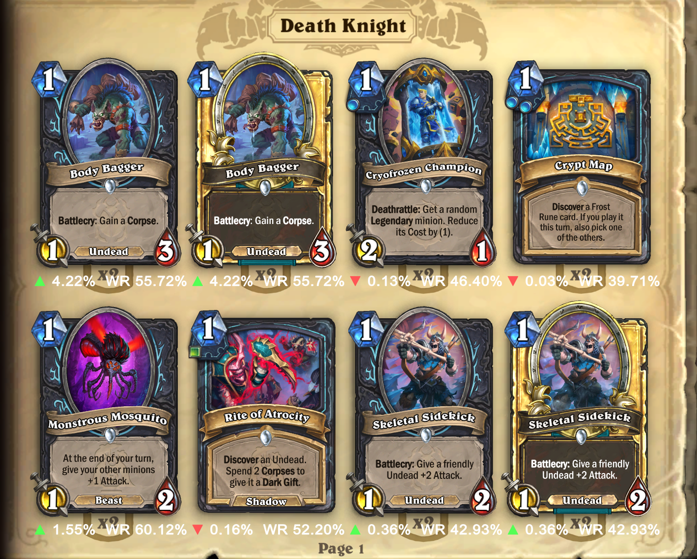

# Firestone HSReplay Card Popularity

A BepInEx plugin for Hearthstone/Firestone that retrieves Standard card statistics for the Gold rank range from HSReplay and displays them as an in-game Collection overlay.

> **Vibecoded software:** This project was created with AI-assisted, experimental development. Use it at your own risk. Hearthstone modding may violate Blizzard's Terms of Service and could result in account or installation issues.

> Hearthstone modding can violate Blizzard's Terms of Service. Use at your own risk.

## Current status

The repository currently contains the plugin foundation and statistics client. The Hearthstone assembly references and the final tooltip component hook must be matched to the Hearthstone/Firestone build being used.

## Configuration

The plugin creates `BepInEx/config/com.firestoneapp.CardPopularity.cfg`:

- `Enabled`: enable/disable the plugin overlay and HSReplay requests. In Firestone, use **Settings > Mods > Firestone HSReplay Card Popularity**. Firestone applies the change after a Hearthstone restart.
- `GameType`: `RANKED_STANDARD`
- `RankRange`: `BRONZE_THROUGH_GOLD` (HSReplay's Gold page uses this range)
- `TimeRange`: `LAST_14_DAYS`
- `RefreshMinutes`: cache duration
- `ApiBaseUrl`: HSReplay API base URL, configurable because the endpoint is not a stable public contract
- `PreferNormalCards`: normalize cosmetic variants before lookup

## Building

Add the Hearthstone/Firestone managed DLL references used by the local game installation to the `HearthstoneReferences` item group in the `.csproj`, then build with .NET Framework 4.7.2.

